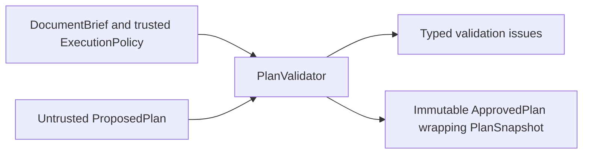

# Milestone 2B P1: domain contracts and plan validation

P1 implements internal contracts and deterministic authorization only. The
[approved specification](milestone-2b-technical-specification.md) and ADRs
[0003](../adr/adr-0003-adaptive-bounded-orchestration.md),
[0004](../adr/adr-0004-execution-governance-and-outcomes.md) and
[0005](../adr/adr-0005-in-memory-artifacts-and-internal-api.md) remain the design for
later phases; their execution requirements are not implemented by P1.

## Components and trust boundary

The [workflow package](../../src/executive_writer/workflow/__init__.py) is independent
of FastAPI handlers and provider SDKs:

| Module | Implemented responsibility |
| --- | --- |
| [contracts.py](../../src/executive_writer/workflow/contracts.py) | Frozen, strict, extra-forbidding Pydantic base and bounded text/identifier types |
| [models.py](../../src/executive_writer/workflow/models.py) | Brief, constraints, provenance, versioned artifacts, attempts, usage and terminal results |
| [stages.py](../../src/executive_writer/workflow/stages.py) | Closed stage enum and canonical initial/optional/final stage ordering |
| [policies.py](../../src/executive_writer/workflow/policies.py) | Denied-by-default research permission and explicit required budget ceilings |
| [planning.py](../../src/executive_writer/workflow/planning.py) | Async `Planner.propose` protocol, untrusted proposal and serializable audit snapshot |
| [validation.py](../../src/executive_writer/workflow/validation.py) | Schema feedback, semantic checks, authorization and validator-issued `ApprovedPlan` |
| [errors.py](../../src/executive_writer/workflow/errors.py) | Layered planning diagnostics and safe execution error classifications |

`validate_json` parses JSON, while `validate` accepts typed/Python input. Both return
`PlanValidationResult` with either an approval or issues. Schema feedback omits input
values, exception messages and arbitrary unknown field names. Typed proposals are
revalidated to detect unchecked Pydantic copies. Trusted brief/policy configuration
errors raise Pydantic validation errors rather than being attributed to the planner.

## Contract clarifications

- A proposal lists **optional stages only**. Python always adds
  `UNDERSTAND -> PLAN -> VALIDATE`, then selected `RESEARCH -> ANALYZE -> OUTLINE`,
  then `DRAFT -> REVIEW`. Draft/review cannot be omitted or reordered through this
  contract. These stage names describe a future execution path; P1 invokes none.
- Unknown stages, duplicates, invalid order, mandatory stages or `REVISE` selected
  as optional, and absent/forward/self dependencies are rejected. Optional stages
  do not implicitly require every earlier optional stage: supplied-material
  analysis and direct drafting are supported. Explicit dependencies must precede
  their consumer. Selected research additionally requires research questions.
- Research requires permission in **both** brief and policy, plus a positive
  research-round ceiling. The approved permission snapshot is their intersection.
  Research questions/gaps can be recorded without selecting research.
- Budgets have no new product defaults: trusted callers supply all ceilings.
  Proposal-requested limits must be within policy and can only reduce approved
  ceilings. Planner fields for permissions, tools or replacement requirements
  are forbidden. No dynamic dispatch or network/tool execution exists.
- `ApprovedPlan` is a frozen dataclass issued through the validator. Its immutable
  Pydantic `snapshot` serializes to JSON; deserializing a `PlanSnapshot` is audit
  reconstruction and does **not** grant approval. Revalidate its proposal against
  the current trusted brief and policy to obtain approval. This prevents accidental
  type confusion, not malicious Python code running inside the process.
- Artifacts use immutable nested models and tuples, explicit IDs, positive versions,
  and a schema version. Evidence records source kind (`supplied`, `external`, or
  `synthetic`), uncertainty, provenance and optional timezone-aware timestamps.
  Future fakes must label their sources synthetic; P1 creates no fake evidence.
  `ArtifactRecord` carries a discriminated payload, producer attempt, consumed IDs
  and timestamp; there is no artifact store or append-only runtime history yet.
- Terminal lifecycle and quality are separate. Completed results require a draft,
  matching accepted review, mandatory checks and no error. Accepted review cannot
  contain critical findings. Incomplete results retain a draft; failures require
  a safe error code, including `PLAN_VALIDATION_FAILED`. These are result validation
  rules, not an implemented quality-check algorithm or planning repair loop.

## Verification and remaining work

[Planning tests](../../tests/workflow/test_validation.py) and
[artifact/result tests](../../tests/workflow/test_models.py) pass: **52 tests**.
They cover minimal, analysis-only and research-intensive plans, adversarial schemas,
permission intersection, every budget ceiling, dependency/order failures, strict
numeric types, serialization, immutability and terminal quality invariants.

Observed commands for P1 (using `UV_CACHE_DIR=/tmp/ew-uv-cache` because the default
cache is read-only): locked sync and lock check pass; Ruff lint/format and strict
Pyright pass. Tool runs use `uv run --no-sync` after successful locked sync.
The full `uv run --no-sync pytest -q` stalls in the existing first HTTP test,
`tests/test_api.py::test_health`. A diagnostic run with
`-vv -o faulthandler_timeout=10` shows TestClient waiting in AnyIO's thread portal;
both runs were interrupted. Full API regression verification is **blocked** in this
environment, not passed. Coverage measurement is unavailable (`No module named
coverage`); the configured 90% threshold is unchanged and not verified here.

No dependency, API, configuration or infrastructure behavior changed. Remaining
P2 work includes execution interfaces/components, bounded planner corrections with
explicit failure on exhaustion, executor state/transitions, attempts and budget
consumption, deadline/cancellation handling, artifact history, deterministic stages
and review-driven routing as assigned by subsequent phase tasks. There is no
fallback workflow, execution engine, real model, external research or public
execution endpoint in P1.

Memory retention limits, evidence sufficiency, deterministic quality checks and
operational error/retry taxonomy remain later implementation decisions identified
by the specification. Public deployment still requires the
[security prerequisites](../operations/status.md); P1 is not a production readiness
claim. No architecture deviation or new provider/infrastructure decision was made.
