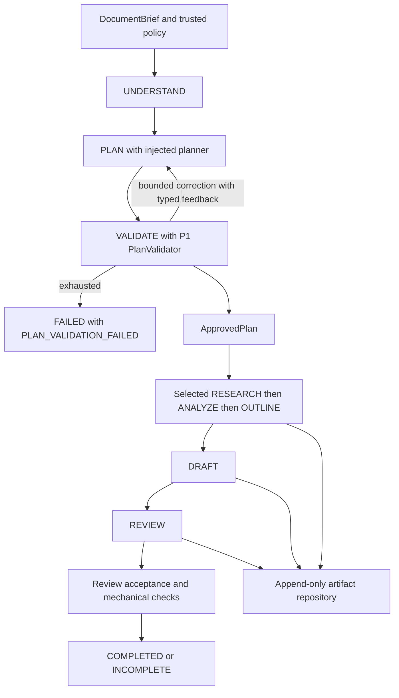

# Milestone 2B P2: in-memory orchestration

P2 adds an internal sequential asynchronous executor to the [P1 contracts](milestone-2b-p1.md).
Comparison baseline: local `main` at `d374bac`; the implementation branch already pointed
at that revision. The HTTP request path and public schemas remain unchanged. There are no
real models, external retrieval, database, queue, worker or public execution endpoints.

## Approved roadmap clarification

The [P2 task](../../tasks/milestone-2b/p2-orchestration-engine.md) and current user instruction
revise the phase sequence after the original [specification](milestone-2b-technical-specification.md):

| Phase | Scope/status |
| --- | --- |
| P1 | Domain contracts and plan validation; implemented |
| P2 | In-memory orchestration with simulations; implemented with verification blockers below |
| P3 | Durable execution: SQLite, SQLAlchemy/Alembic, dedicated worker, durable queue and PostgreSQL portability; deferred |
| P4 | Review-driven revision and research re-entry; deferred |
| P5 | Final milestone verification; deferred |

ADRs [0003](../adr/adr-0003-adaptive-bounded-orchestration.md),
[0004](../adr/adr-0004-execution-governance-and-outcomes.md) and
[0005](../adr/adr-0005-in-memory-artifacts-and-internal-api.md) are preserved. Their original
milestone-wide persistence deferral must be reconciled in a follow-up ADR before P3:
record durable lifecycle/recovery, transaction and queue ownership, retention/deletion,
worker cancellation and migration/portability decisions. P2 does not select those details
or silently supersede the accepted ADRs.

## Implemented components

| Module | Responsibility |
| --- | --- |
| [executor.py](../../src/executive_writer/workflow/executor.py) | `WorkflowExecutor.execute(brief, policy)`, execution-local coordinator, planning, sequencing, lifecycle history, attempts, limits and terminalization |
| [components.py](../../src/executive_writer/workflow/components.py) | Narrow async researcher, analyst, outliner, drafter and reviewer protocols; frozen `WorkflowComponents` container |
| [reporting.py](../../src/executive_writer/workflow/reporting.py) | Trusted per-call `ResourceBudget`, explicit `ModelUsage` and generic `ComponentResult` |
| [repository.py](../../src/executive_writer/workflow/repository.py) | `ArtifactRepository` port and append-only `InMemoryArtifactRepository` |
| [quality.py](../../src/executive_writer/workflow/quality.py) | Mechanical completion checks, without factual verification |
| [failures.py](../../src/executive_writer/workflow/failures.py) | Explicit transient/permanent `ComponentFailure` and cancellation carrying a terminal snapshot |
| [fakes.py](../../src/executive_writer/workflow/fakes.py) | Synthetic planner/stages for deterministic offline scenarios; UUID metadata is freshly allocated |

## Authorization and execution behavior

The service validates trusted inputs, allocates a fresh repository per execution, invokes
planning even for rewrites (subject to resource availability), and validates each proposal.
Only the validator-issued plan supplies executable stages. Unknown/forbidden proposals are
returned as safe typed feedback for the allowed corrections; exhaustion fails without a
fallback. Optional components are invoked only when selected. Missing selected components
fail safely. No shared execution state is passed to components; skipped inputs are `None`.

`UNDERSTAND` and `VALIDATE` create real bookkeeping attempts with zero model usage.
A selected research plan is retained at validation, produced by `VALIDATE`. Other artifacts
are appended only after runtime schema, version and provenance validation; no placeholders
are generated for omitted stages. Attempts retain producer/consumer IDs, timing, outcome,
safe errors and reported usage. Lifecycle history records planning, executing, reviewing
and the terminal state; this is not a durable state machine or job registry.

The repository takes immutable typed records and returns tuple snapshots. It rejects reused
artifact IDs, missing/duplicate consumed IDs, wrong producer kinds, invalid model instances,
chronologically impossible provenance and nonconsecutive versions. Versions are consecutive
**per artifact kind within an execution**; a subsequent version gets a new ID and consumes
its predecessor. Analysis/outline evidence IDs must exist, supplied source references must
match the brief, source IDs must have consistent metadata, and reviews must target the
current draft. Drafts with unavailable citation IDs are retained but fail completion checks.
The executor depends on a small synchronous repository port; P3 must decide how durable I/O
is offloaded/awaited rather than inserting blocking database calls into async execution.

## Governance and narrow P1 contract extensions

`Planner.propose` now returns `ComponentResult[ProposedPlan]` and exposes a `budget`
property, like each stage port. This changes the internal P1 planning interface because its
previous bare proposal could not report usage. No public API contract changes.

Before an invocation, Python checks remaining total time and verifies that the trusted
component's declared maximum model calls/tokens fit within the remaining approved ceilings.
Afterwards it validates and charges the explicit usage report and rejects any declared or
aggregate ceiling overrun before accepting output or starting another stage. No token or
model-call counts are inferred from text. Fakes explicitly report synthetic calls/tokens;
result/attempt usage marks synthetic counts. Unknown usage after an unexpected failure,
timeout or cancellation is marked `reporting_complete=false`, never presented as a complete
zero-cost report. Future provider adapters must enforce their declared reservations and
report real incurred usage, including failures; P2 makes no monetary-spend guarantee.

Planning corrections, logical research rounds, operational retries and quality revisions
have separate counters. Each proposal permits at most `max_attempts_per_stage` operational
attempts; corrections are separate proposals, bounded by `max_planning_corrections`.
Thus planner invocations are additionally bounded by
`(1 + max_planning_corrections) * max_attempts_per_stage` and the global resource/deadline
ceilings. Initial research charges one logical round, including any operational retry.
P2 performs no quality revisions. All accepted smaller proposal ceilings apply to resources
already spent as well as remaining work; the original execution start anchors the deadline.

Only `ComponentFailure(transient=True, usage=...)` permits an immediate bounded retry in
this offline phase. Permanent, malformed-output and unexpected failures do not retry. A
single monotonic deadline surrounds awaited component work and is checked at transitions.
Timeouts are recorded as `TIMED_OUT`. Async cleanup is cooperative; this is not process
isolation and cannot forcibly preempt blocking or malicious in-process Python components.

External asyncio cancellation is re-raised as `WorkflowCancelled`, a `CancelledError`
subclass carrying `.result` with status `CANCELLED`. The task remains cancelled; cancellation
is not converted into a successful return. The active attempt is recorded, and later stages
do not run. Callers that need the snapshot can catch the subtype around their await.

## Quality and terminal semantics

`COMPLETED` requires review acceptance and the following deterministic checks:

- Nonblank draft text.
- Word count (whitespace splitting) within `max_words` when supplied.
- Required sections present as standalone ATX Markdown headings outside fenced code blocks;
  title matching ignores case and optional closing heading hashes. This is a narrow check,
  not full Markdown parsing, semantic structure validation or safe rendering.
- Every citation's evidence ID exists in the supplied stage evidence set.

An accepted review cannot override these checks. A rejected review produces `INCOMPLETE`
with the latest draft, structured findings and disclosed limitations; no revision/research
re-entry occurs. Missing evidence IDs are disclosed without inventing support. Valid synthetic
research can complete its simulated workflow while explicitly disclosing that no external
facts were verified. Evidence existence never proves that a claim is true or supported.

Deadline, resource, stage or output failure returns `FAILED` without a usable draft and
`INCOMPLETE` when a usable draft is retained. Diagnostics expose safe error enums rather
than raw exception or source text. Artifact/result inspection is internal only and still
contains potentially confidential content; nothing is logged or persisted by the executor.

## Verification and residual gaps

[Execution tests](../../tests/workflow/test_execution.py) and
[repository tests](../../tests/workflow/test_repository.py), together with P1 tests, currently
pass **130 workflow tests**. Coverage includes rewrites, analysis-only and synthetic research
paths; repair/exhaustion; mandatory ordering and skipped inputs; immutable provenance and
versions; malformed output/usage; source and citation failures; review/quality gates;
preflight limits and overruns; explicit retry classification; deadlines and cancellation;
concurrent execution isolation; and no later stage after budget/cancellation failures.
Two existing configuration rejection tests also pass independently.

Observed commands use `UV_CACHE_DIR=/tmp/ew-uv-cache` because the default cache is read-only:

| Gate | Observed result |
| --- | --- |
| `uv sync --locked` and `uv lock --check` | Passed |
| `uv run ruff check .` / `uv run ruff format --check .` | Passed |
| `uv run pyright` | Passed, strict mode |
| `uv run pytest -q tests/workflow` | 130 passed |
| `uv run pytest -q tests/test_foundation.py -k invalid_settings` | 2 passed, 7 deselected |
| Full pytest with a 10-second faulthandler diagnostic | Stalled in existing `test_health` TestClient/AnyIO thread portal; interrupted |
| `uv run --with pytest-cov==7.0.0 pytest -q --cov --cov-report=term-missing` | Blocked before tests: PyPI DNS resolution failure fetching pytest-cov |

Offline Bandit/pip-audit attempts were blocked because their packages are not cached;
the Docker daemon socket is permission-denied, so container/Gitleaks/Trivy verification
could not run. Temporary uv tool/cache paths were used to avoid read-only host directories.

The >=90% coverage threshold is unchanged but **not verified**. Full API regression tests
and configured CI security/container gates are not claimed passed. No CI, dependencies,
lockfile, infrastructure or production security settings were changed. See
[deployment/security status](../operations/status.md). Mermaid was manually inspected;
no dedicated Mermaid validator was available. Documentation relative links and
`git diff --check` are checked before delivery.

No new material architectural decision requiring approval was needed for P2. The approved
roadmap requires the P3 ADR follow-up described above; durable recovery/retention and
P4 evidence sufficiency, reviewer prioritization and routing remain open. Human or CI
verification of the blocked test/coverage/security gates is still required before release.
