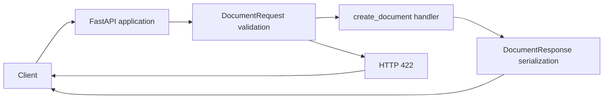
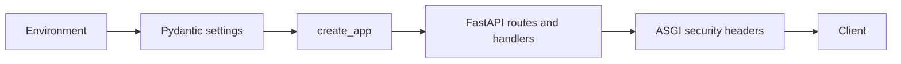

# Architecture and request lifecycle

## Implemented components

The package under `src/executive_writer/` contains HTTP routing, boundary models and
[internal workflow contracts and plan validation](milestone-2b-p1.md).
There is no workflow execution, provider adapter, storage, queue or worker.
Package `__init__.py` files contain descriptive docstrings without initialization logic.

| Component | Responsibility | Evidence |
| --- | --- | --- |
| Application | Creates FastAPI with title/version, includes the document router, defines health handler | [main.py](../../src/executive_writer/main.py) |
| Document router | Creates a UUID v4 and returns an acceptance response | [api/documents.py](../../src/executive_writer/api/documents.py) |
| Boundary models | Validate requests and define the response contract | [models/documents.py](../../src/executive_writer/models/documents.py) |

## Request flow

For `POST /documents`, FastAPI parses the JSON body into `DocumentRequest`.
Pydantic checks required fields, types, the document-type literal and the nonblank objective validator.
Invalid input returns HTTP 422 through framework validation handling.
For valid input, the synchronous `create_document` handler creates a UUID and constructs
`DocumentResponse`; FastAPI serializes it as HTTP 202 JSON using the response model.

`GET /health` returns a typed static health response. It does not check dependencies or readiness.
See the [API reference](../api/reference.md) for all routes and contracts.

## Boundaries and limitations

The HTTP body is untrusted input. Pydantic is the current validation boundary; there is no
workflow integration in the HTTP request path. The separate internal P1 validator
authorizes proposed plans against trusted brief/policy permissions and limits. Request fields are not sent to a
model, retrieved from external resources, or persisted. The UUID has no retrieval endpoint or
stored job behind it. HTTP 202 does not establish background processing or durability.

The research, evidence, outline, draft, review and finalization pipeline in the
[requirements](../requirements.md) is desired behavior. P1 implements its domain
contracts and plan validation only; execution remains deferred.
Docker/OCI packaging is authored under [ADR 0001](../adr/0001-oci-packaging.md);
its verification remains blocked. `create_app` owns validated environment settings, middleware
and safe exception handlers. No new business or infrastructure services were introduced.

See [security status](../operations/status.md) for controls and deployment prerequisites.
